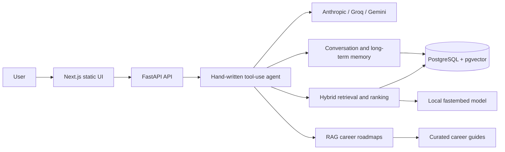
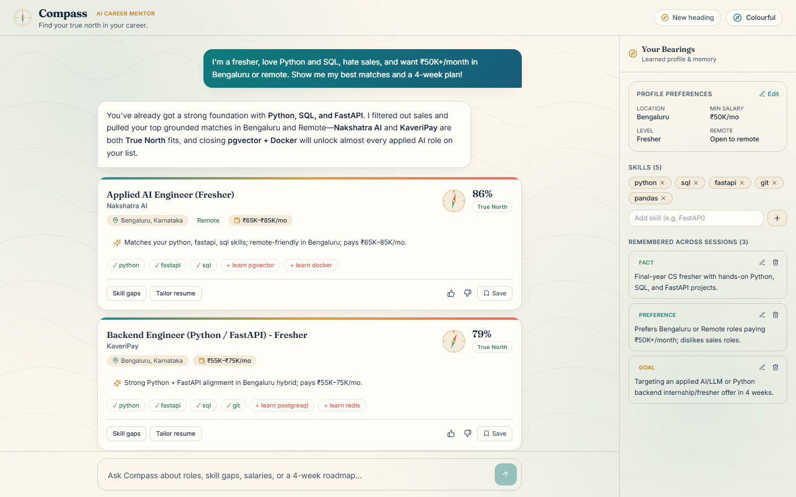
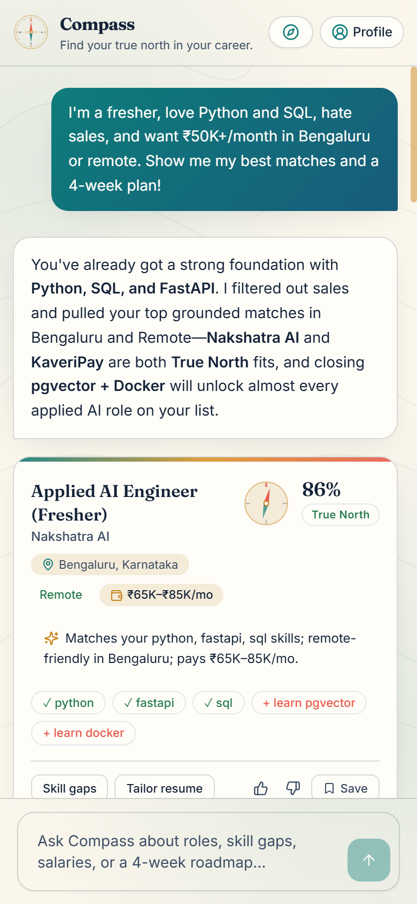
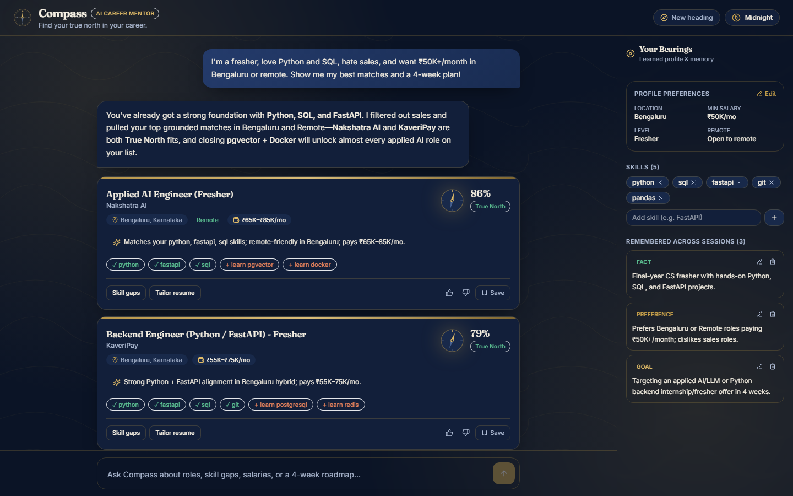
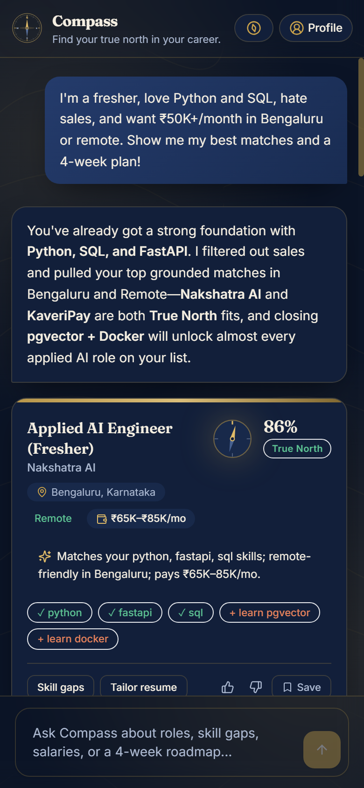
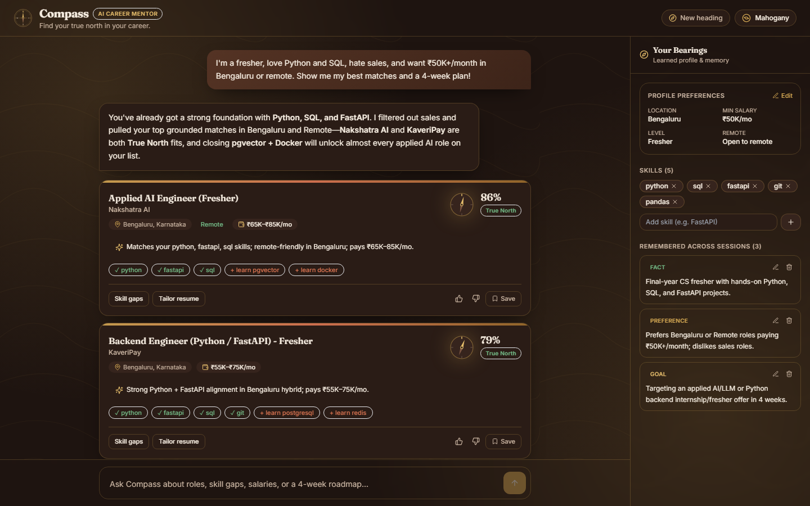
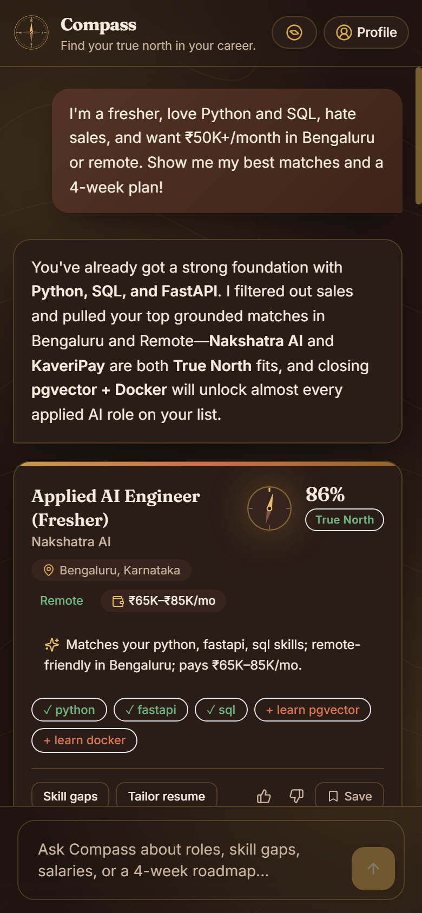

# Compass

> **Find your true north in your career.**

Compass is a conversational career mentor for freshers and interns in India. It combines grounded job search, skill-gap analysis, persistent preferences, and citation-backed career roadmaps in a single web app.

## Project status

- [x] **Stages 1–7:** API and database, job data and embeddings, hybrid retrieval and ranking, grounded agent, memory, RAG roadmaps, and the Compass UI.
- [x] **Stage 8:** 50-profile retrieval evaluation, 30-conversation generation evaluation, and GitHub Actions CI.
- [ ] **Stage 9:** Render + Neon deployment and public-URL smoke test. [`render.yaml`](render.yaml) is ready; deploy credentials and a Neon database must be configured in Render.
- [x] **Stage 10:** Documentation, evaluation results, screenshots, and interview prep.

## Architecture



The API serves the statically exported frontend from the same container. PostgreSQL stores profiles, jobs, embeddings, conversations, memories, feedback, and roadmap milestones. Search combines pgvector cosine similarity with PostgreSQL full-text search using Reciprocal Rank Fusion; ranking then considers skills, preferences, freshness, and user interactions. The agent uses validated tools rather than an agent framework and grounds job references in retrieved database records. See [`docs/schema.md`](docs/schema.md) for the schema.

## Evaluation results

Results are from [`evals/results.md`](evals/results.md): 50 labelled profiles evaluated against 320 seed jobs, plus 30 LLM-judged conversations.

| Retrieval strategy | Recall@10 | nDCG@10 |
| --- | ---: | ---: |
| Vector-only | 0.7031 | 0.7038 |
| Keyword-only | 0.7199 | 0.7382 |
| Hybrid (RRF, k=60) | 0.7602 | 0.7570 |
| **Hybrid + reranking** | **0.7586** | **0.8322** |

Generation evaluation: **30/30** conversations scored, with no parse/API failures; mean groundedness **4.47/5**, relevance **4.53/5**, and actionability **4.53/5**. All **39/39** referenced job IDs existed in the evaluated job data. The generation scores use an LLM-as-judge and should be treated as evaluation signals, not independent human ratings.

Run retrieval-only evaluation without an LLM key using `python -m evals.run --skip-llm`. Run both retrieval and generation evaluations with a configured LLM provider using `python -m evals.run`.

## Features

- **Jobs:** 320 clearly identified sample postings for Indian fresher and intern roles, plus incremental public-job ingestion from Remotive and Arbeitnow.
- **Skill analysis:** deterministic skill extraction and SQL-based gap analysis.
- **Search:** hard SQL filters, pgvector semantic search, Postgres full-text search, RRF merging, and weighted reranking.
- **Career guidance:** a hand-written, bounded tool-use loop with structured validation, job-ID grounding, and JSON/SSE chat responses.
- **Memory:** rolling conversation summaries and editable, deduplicated long-term preferences and facts.
- **Roadmaps:** role-specific plans grounded in eight curated career guides with citations.
- **UI:** Colourful, Midnight, and Mahogany themes, fit-score compass dials, journey roadmaps, streaming chat, and editable profile/memory controls.
- **Operations:** FastAPI health endpoint, request IDs, structured JSON logs, rate limits, Docker, and Alembic migrations.

The seeded postings are synthetic examples, not real vacancies. They use clearly marked sample URLs and should not be treated as live job listings.

## Screenshots

| Theme | Desktop | Mobile |
| --- | --- | --- |
| Colourful |  |  |
| Midnight |  |  |
| Mahogany |  |  |

## Run locally

### Docker Compose

1. Copy `.env.example` to `.env`.
2. Set `LLM_PROVIDER` and the matching API key (`ANTHROPIC_API_KEY`, `GROQ_API_KEY`, or `GEMINI_API_KEY`).
3. Start the API and pgvector database:

   ```sh
   docker compose up --build
   ```

The API applies migrations, seeds the sample jobs and knowledge base, then serves the UI and API at `http://localhost:8000`. Check `http://localhost:8000/health`.

### Python development

Requires Python 3.11+ and a running PostgreSQL instance with the pgvector extension.

```sh
python -m venv .venv
# Windows PowerShell: .venv\Scripts\Activate.ps1
# macOS/Linux: source .venv/bin/activate
pip install -r requirements.txt
alembic upgrade head
uvicorn app.main:app --reload
```

Set `DATABASE_URL` and an LLM provider key in `.env`. For a database without seed data, run `python -m scripts.seed_jobs`.

### Tests, lint, and CI

```sh
ruff check .
pytest -v
```

GitHub Actions runs lint and tests, builds the frontend and Docker image on pushes and pull requests to `main`. The manual workflow in [`.github/workflows/evals.yml`](.github/workflows/evals.yml) runs evaluation jobs and uploads the results artifact; LLM evaluation requires a configured provider secret.

## Deploy to Render + Neon

1. Create a Neon Postgres project and enable the `vector` extension (the Alembic migration also attempts to create it). Copy the Neon connection string, including SSL parameters.
2. In Render, create a Blueprint from this repository and use [`render.yaml`](render.yaml). Supply `DATABASE_URL` and `GROQ_API_KEY` when prompted; the blueprint keeps these values out of the repository.
3. Wait for the Docker build and health check. The container runs Alembic migrations on startup and seeds the sample jobs and guides when the database is empty.
4. Verify the public deployment:

   ```sh
   curl -fsS https://YOUR-RENDER-SERVICE.onrender.com/health
   curl -fsS -X POST https://YOUR-RENDER-SERVICE.onrender.com/chat \
     -H "Content-Type: application/json" \
     -H "X-Compass-User-Id: 00000000-0000-4000-8000-000000000001" \
     -d "{\"message\":\"I'm a fresher looking for Python roles in Bengaluru.\"}"
   ```

The health response should report `"status":"ok"`, `"database":"ok"`, and `"pgvector":true`. Stage 9 is not complete until this live smoke test has passed.

## What I would improve next

- Replace synthetic seed postings with a broader, regularly refreshed set of verified job sources and better expiry handling.
- Add human-reviewed relevance judgments and compare retrieval changes over time, rather than relying only on generated labels and an LLM judge.
- Add authentication, user-data retention controls, and production monitoring before serving real users.
- Expand accessibility, multilingual support, and feedback-driven ranking evaluation.
- Add a larger integration suite against managed Postgres and validate backup/recovery procedures.

## Interview prep: 10 questions

1. **Why combine vector search and full-text search?** Semantic retrieval handles paraphrases; keyword search reliably matches exact skills and terms. RRF merges their rankings without requiring their raw scores to be directly comparable.
2. **How is the final job order produced?** SQL hard filters eliminate ineligible jobs first; retrieval produces candidates; `rank_jobs` combines semantic similarity, skill overlap, preference fit, freshness, and interaction adjustments.
3. **Why use a hand-written agent loop?** The bounded loop makes tool availability, iteration limits, validation, and job grounding explicit, while avoiding a framework dependency for a small fixed workflow.
4. **How do you prevent made-up job recommendations?** Tools retrieve actual job records and responses must reference grounded IDs; the evaluation also checks referenced IDs against the available database IDs.
5. **How does long-term memory handle repeated or changed facts?** Memory embeddings identify similar entries for deduplication, and conflict-aware updates replace stale preferences such as a changed city or salary target.
6. **How are roadmap answers grounded?** Role-specific career-guide chunks are retrieved and supplied to roadmap generation, whose structured output carries citations to those chunks.
7. **What does the retrieval evaluation measure?** Recall@10 measures how many labelled relevant jobs appear in the first ten; nDCG@10 also rewards putting the most relevant jobs nearer the top.
8. **What do the current evaluation results say?** Hybrid plus reranking achieved nDCG@10 of 0.8322, while hybrid alone had the highest Recall@10 at 0.7602. This trade-off suggests reranking improves ordering but does not increase recall in this run.
9. **How is the application deployed?** A multi-stage Docker build exports the Next.js UI and packages it with FastAPI; Render starts the container, Alembic applies migrations, and the app connects to Neon using an SSL-normalized async PostgreSQL URL.
10. **What would you address before production use?** Verified job freshness, authentication and privacy controls, operational monitoring, human-reviewed evaluation data, and managed-database reliability are the highest priorities.
